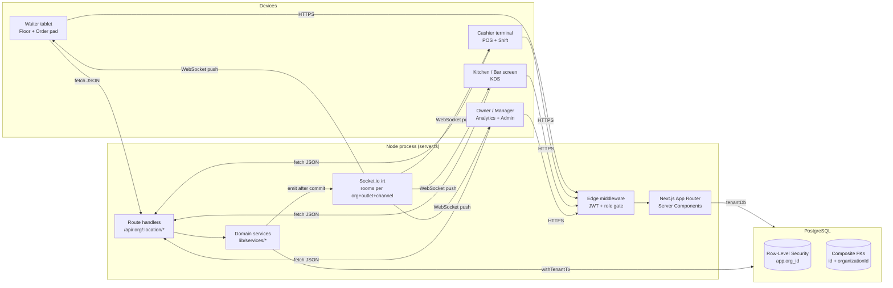

# RMS — System Architecture

A real-time, multi-franchise Restaurant Management System. One deployment serves
many independent franchise owners; each owner runs many outlets; no owner can
ever see, change, or even detect another owner's data.

## 1. High-level view



| Layer | Choice | Why |
|---|---|---|
| UI | Next.js 15 App Router, React 19, Tailwind v4, Radix primitives, Lucide | Server Components render data-heavy screens with zero client JS. Client islands only where touch interactivity is needed (POS cart, KDS, floor drag). |
| Client state | Zustand (cart), React Query (available), URL state (filters, ranges) | The cart must survive re-renders instantly. Everything else is server state. |
| API | Route handlers + thin domain services | Each handler does three things: authorise, validate (Zod), call a service. Services own the transactions. |
| DB | PostgreSQL + Prisma 6 | Relational integrity for money, plus RLS for tenancy. |
| Realtime | Socket.io on the same HTTP server (`/rt`) | Cookie-authenticated handshake, room-level authorisation, automatic reconnect. Swap in the Redis adapter to run more than one node. Supabase Realtime is a drop-in alternative if hosted there. |
| Auth | HS256 JWT in an httpOnly cookie, bcrypt passwords | Stateless, so the edge middleware can gate routes without a DB hit. The DB re-checks on every request. |

## 2. Multi-franchise tenancy: three walls

```
Brand (franchisor, optional)        ─ owns master-menu templates, sees only opt-in rollups
 └─ Organization  ← THE TENANT       ─ one franchise owner's business
     └─ Location                     ─ an outlet (Thamel, Patan…)
         └─ floors, tables, orders, tickets, shifts, stock, rollups
```

**Wall 1: the URL and the JWT (edge).** Every screen lives at
`/{orgSlug}/{locationSlug}/{module}`. The JWT carries a compact membership list
(`[{o: orgId, s: orgSlug, r: role, l: locationSlugs | "*"}]`). `middleware.ts`
rejects any org or outlet that isn't in the token, and any module the role can't
open. Unknown orgs return **404, not 403**, so a franchise can't even probe for
another's existence.

**Wall 2: Postgres Row-Level Security.** Request-scoped queries run as the
restricted role `rms_app` through `tenantDb(orgId)` / `withTenantTx(orgId)`. Both
wrap every statement in a transaction that runs
`set_config('app.org_id', orgId, true)`. `prisma/rls.sql` attaches a policy to
every table with an `organizationId` column (and to child tables through their
parent). If a code path forgets to set the tenant, `current_setting` is NULL and
every query returns **zero rows**, so the system fails closed. Tested:

```
no tenant set           → SELECT count(*) FROM "Order"  = 0
as Everest              → Annapurna's menu item by id   = 0 rows
as Everest              → INSERT row tagged Annapurna   = ERROR: violates row-level security policy
rms_app                 → SELECT FROM "Session"         = ERROR: permission denied
```

**Wall 3: composite foreign keys.** Every child→parent relation includes
`organizationId` (`@@unique([id, organizationId])` on parents). Even the owner
role, which bypasses RLS, can't create an order line for Owner A that points at
Owner B's menu item:

```
ERROR: insert or update on table "OrderItem" violates foreign key constraint
       "OrderItem_menuItemId_organizationId_fkey"
```

Identity is global and authority is local. A `User` is one login. A `Membership`
grants a role in **one** organization, optionally limited to some outlets
(`MembershipLocation`). The same person can work for two franchise owners with
two separate memberships, and the data never mixes.

Only `lib/db/system.ts` (owner role) bypasses RLS. It is used for login, tenant
resolution and provisioning, and never for serving tenant data.

## 3. Role-based access control

`lib/auth/rbac.ts` is the single source of truth. The middleware, server layouts,
API handlers, socket room joins and the sidebar all read from it.

| Role | Modules | Lands on |
|---|---|---|
| OWNER | everything, all outlets + portfolio page | `/{org}` portfolio |
| MANAGER | everything at assigned outlets | Analytics |
| CASHIER | `pos` (checkout, split bills, active tables), `shift` | POS |
| WAITER | `floor`, `orders` | Floor plan |
| KITCHEN / BAR | `kds`, pinned to their station | KDS (full-screen, no sidebar) |

Fine-grained actions (`order.void`, `payment.capture`, `ticket.bump`,
`floor.edit`, …) are checked in handlers with `can(role, action)`. The JWT lives
up to 12h, so `resolveTenant()` re-reads the membership from the DB on every
request. A deactivated waiter is locked out immediately.

## 4. Real-time flow

```mermaid
sequenceDiagram
  participant W as Waiter tablet
  participant API as POST /orders
  participant DB as Postgres
  participant IO as Socket.io
  participant K as Kitchen KDS
  participant B as Bar KDS
  W->>API: lines[], tableId, idempotencyKey
  API->>DB: BEGIN; set app.org_id; re-price from DB; create order, items, 1 ticket per station; COMMIT
  API-->>W: 201 {orderId}
  API->>IO: emit ticket.created → org:{id}:loc:thamel:kds
  IO-->>K: KITCHEN ticket (chime + arrive animation)
  IO-->>B: BAR ticket
  K->>API: PATCH /tickets/:id {IN_PREPARATION}
  API->>IO: ticket.updated → every KDS + waiter screen
```

- **Rooms:** `org:{orgId}:loc:{slug}:{floor|kds|pos|dashboard}`. A join is authorised
  against the JWT. Tested: a kitchen user asking for another franchise's room, or for
  the dashboard room, gets `forbidden`.
- **Emit after commit only**, so clients never see a state that rolled back.
- **Reconnect:** `useChannel` rejoins automatically and calls `onResync`
  (`router.refresh()`) to pull anything missed while offline.
- **Scale-out:** `io.adapter(createAdapter(pub, sub))` with Redis. Room names are
  already globally unique.

## 5. Correctness under service pressure

| Risk | Defence |
|---|---|
| Flaky Wi-Fi double-submits an order or payment | Client-generated `idempotencyKey` (unique). A replay returns the original result. |
| Client sends a tampered price | Server re-reads prices, location overrides and modifier validity inside the transaction. Client totals are for display only. |
| Float rounding on money | All money is integer minor units. Tax and service are in basis points. `allocate()` splits bills with the largest-remainder method, so no cent is lost (e.g. 101926 → 33976 / 33975 / 33975). |
| Cart total differs from the charged total | `lib/pricing.ts` is shared by the cart UI and the API. |
| Two managers drag the same table | `version` optimistic lock → 409 "changed on another device". |
| Concurrent payments clobber analytics | Rollup row is `SELECT … FOR UPDATE`-locked inside the payment transaction. |
| Order numbers collide across terminals | `OrderCounter` upsert-increment per outlet per business day. |
| A 1 a.m. sale lands on the wrong day | `businessDate` is computed in the outlet's own timezone. |
| Menu edits rewrite old receipts | Order lines snapshot name, price and modifiers. |

## 6. Analytics

Dashboards never scan raw orders for KPIs. Each payment incrementally updates
`DailySalesSummary(location, businessDate)`: gross/net/tax/discount, order and
guest counts, and JSON breakdowns `byPaymentMethod`, `byCategory`, and a 24-slot
`byHour`. Today, 7 days, 30 days or a custom range is a read of at most a few
hundred rows, and the "vs previous period" delta is one more such read. Top
sellers use a `groupBy` on order lines, bounded by the indexed date range.
`payment.captured` on the `dashboard` channel makes open dashboards refresh live.

## 7. Frontend structure

```
app/
  login/                         sign-in
  [org]/page.tsx                 owner portfolio (all outlets side by side)
  [org]/[location]/layout.tsx    AppShell (tenant resolved + verified here)
    floor/      drag-and-drop floor plan, status colours, quick-action drawer
    orders/     waiter order pad (?table=) / open-orders list
    pos/        checkout: menu grid, cart, active tables, payment + split
    kds/        kanban: New → In preparation → Ready → Served, live timers
    shift/      open/close drawer, expected vs counted cash
    analytics/  KPIs, peak hours, top sellers, breakdowns
    menu/ inventory/ staff/ settings/
  api/[org]/[location]/
    orders/                      POST create-or-fire
    orders/[id]/payments/        POST capture (FULL | EQUAL | BY_SEAT)
    tickets/[id]/                PATCH KDS status
    tables/[id]/ (merge|transfer)  PATCH status/position, POST merge/transfer
components/
  shell/   app-shell, sidebar (role-filtered), topbar (outlet switcher, live dot, clock, theme)
  pos/  kds/  floor/  analytics/  ui/ (button ≥48px, card, sheet)
lib/
  auth/    rbac, jwt (edge-safe), session (DB-verified tenant), api (handler guard)
  db/      system (RLS-bypass, auth only), tenant (RLS-scoped)
  realtime/ events (typed contract), server, client hooks, emit
  services/ orders, tables     pricing.ts  money.ts  queries.ts
prisma/  schema.prisma  rls.sql  seed.ts
```

### UX rules baked into the components
- Every tap target is **≥ 48px** (`Button` sizes start at `h-12`; POS tiles 120px tall).
- Light and dark themes come from OKLCH tokens in `globals.css`. Status colours are
  reserved and **always paired with an icon or label** (KDS timers: clock, then
  stopwatch, then alarm; table legend with counts).
- Tabular numerals everywhere, so prices don't jitter while totals update.
- Motion: `animate-arrive` for new cart lines and tickets, `animate-pulse-ring` for
  live updates, a success state on payment. All of it is disabled under
  `prefers-reduced-motion`.
- POS keyboard: `/` search · `Enter` add the exact code or top hit · `+`/`−` change
  qty of the last line · `F2` / `Ctrl+Enter` charge or send · `Esc` clear.

## 8. Roadmap (next phases)
1. Menu, staff, inventory and location **editors** (the pages are currently read-only views).
2. Recipe-based stock deduction on payment (`RecipeLine` → `StockMovement`) and low-stock alerts.
3. Discounts with manager-PIN override (`Membership.pinHash`), item voids, refunds, and audit-log writes.
4. Reservations calendar (schema ready). Printing: receipts and kitchen chits.
5. Brand (franchisor) console: master-menu publish, network report from opt-in rollups.
6. Offline queue on terminals (IndexedDB + idempotency keys already make replay safe).
7. Redis socket adapter + horizontal scaling. Refresh-token rotation (`Session` table ready).
